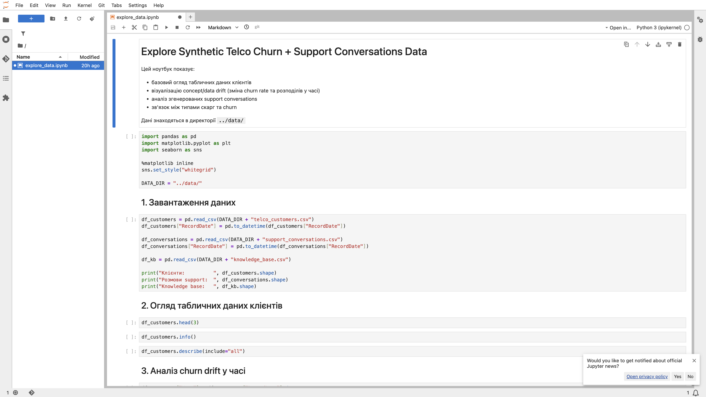
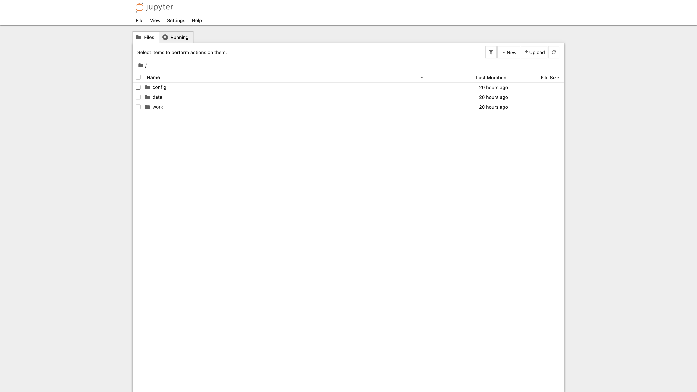
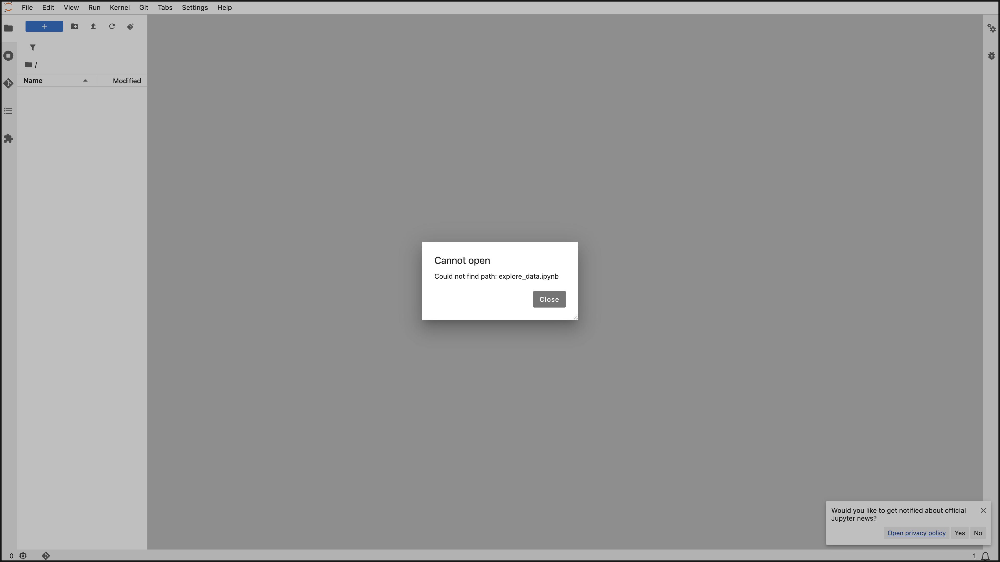

# Screenshots

Telco homework. Leonid328. VPS `168.231.116.71`.

## Jupyter notebook



## Jupyter files



## Jupyter UI



## docker ps

```text
Tue Nov  3 18:02:32 UTC 2026

NAMES                             STATUS                 PORTS
mlops-prep-app-1                  Up 2 hours             0.0.0.0:8000->8000/tcp
mlops-prep-redis-1                Up 2 hours (healthy)   6379/tcp
telco-churn-synthetic-jupyter-1   Up 2 hours (healthy)   0.0.0.0:8888->8888/tcp
ecommerce-start-chat-agent-1      Up 2 hours             0.0.0.0:8501->8501/tcp
```
